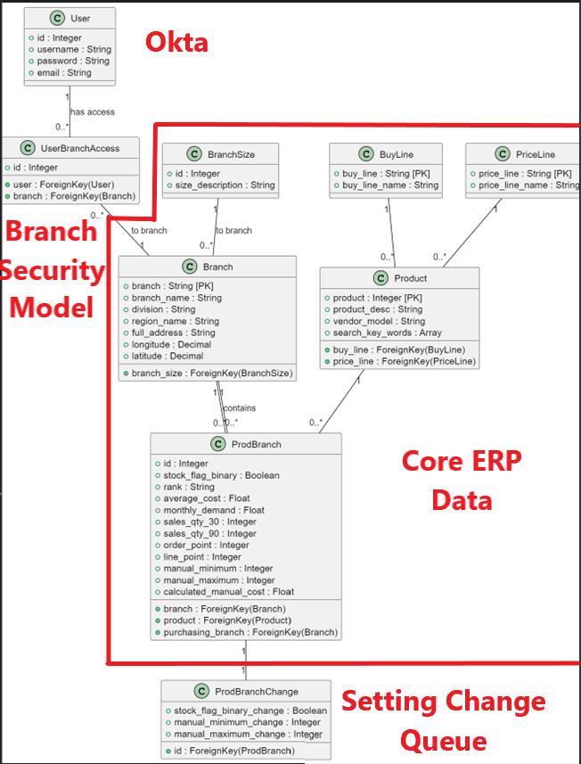

# Inventory API Platform
This project demonstrates an API-first platform that integrates legacy ERP data with modern analytics workflows.
It combines backend APIs, data pipelines, and analytics processing to support both operational workflows and data-driven decision making.
The platform simulates how enterprise systems expose and orchestrate data across services instead of relying on direct database access.

## Features
- Python-based API and service layer
- Data pipelines integrating ERP-style data into an analytics layer
- Snowflake-style analytics workflows (simulated)
- Command-based processing for batch data operations
- Event-driven and scheduled job patterns
- API-first architecture enabling reusable data services

## Architecture
ERP Data → Data Pipeline → Analytics Layer → Python APIs → Consumers

- ERP data is extracted and transformed
- Analytics views are created for reporting and decision-making
- Python-based commands and APIs orchestrate workflows
- Data is exposed through APIs instead of direct database access

## Purpose
This project is a sanitized example of how enterprise platforms evolve from tightly coupled systems into scalable, API-driven architectures.
It highlights patterns for:
- Data orchestration
- API-first design
- Analytics integration
- Backend service design

# inventory_stock_management
Web application developed to support management of stock for Inventory USA

# Table of Contents
- [Inventory Stock Management](#inventory_stock_management)
- [Basic Commands](#basic-commands)
  - [Setting Up Your Users](#setting-up-your-users)
  - [Data Migrations](#data-migrations)
  - [Shell Interactivity](#shell-interactivity)
  - [App Creation](#app-creation)
  - [Type Checks](#type-checks)
  - [Test Coverage](#test-coverage)
  - [Running Tests with Pytest](#running-tests-with-pytest)
- [Email Server](#email-server)
- [Sentry](#sentry)
- [Initialization / Deployment](#initialization--deployment)
- [Production Launch Steps](#production-launch-steps)
- [Directory Diagram](#directory-diagram)
- [Database UML](#database-uml)
- [Docker Cookiecutter Docs](#docker-cookiecutter-docs)

---
## Basic Commands
- Note, application is docker-compose structured, so commands would need to be run through docker:
- local:
      $ docker-compose -f docker-compose.local.yml run --rm django...
- production:
      $ docker-compose -f docker-compose.production.yml run --rm django...

### Setting Up Your Users
- Note, running the docker-compose.local.yml will spin up a mailpit service, all emails (incldung verification emails) wil be dropped into this portal as opposed to actually being sent... (See below section on email server)
- To create a **normal user account**, just go to Sign Up and fill out the form. Once you submit it, you'll see a "Verify Your E-mail Address" page.
- To create a **superuser account**, use this command:
      $ python manage.py createsuperuser
- Super users will have access to the admin portal via the UI.

### Data Migrations
      $ python manage.py makemigrations
      $ python manage.py makemigrations

### Shell Interactivity
      $ python manage.py shell

### App Creation
- Note, the django app will be created at the root level, you'll need to move it under the inventory_stock_management directory
      $ python manage.py createapp {app_name}

### Type checks
Running type checks with mypy:
    $ mypy inventory_stock_management

### Test coverage
To run the tests, check your test coverage, and generate an HTML coverage report:
    $ coverage run -m pytest
    $ coverage html
    $ open htmlcov/index.html

### Running tests with pytest
    $ pytest
---
## Email Server
In development, it is often nice to be able to see emails that are being sent from your application. For that reason local SMTP server [Mailpit](https://github.com/axllent/mailpit) with a web interface is available as docker container.
Container mailpit will start automatically when you will run all docker containers.
Please check [cookiecutter-django Docker documentation](https://cookiecutter-django.readthedocs.io/en/latest/2-local-development/developing-locally-docker.html) for more details how to start all containers.

With Mailpit running, to view messages that are sent by your application, open your browser and go to `http://127.0.0.1:8025`

---

## Sentry

Sentry is an error logging aggregator service. You can sign up for a free account at <https://sentry.io/signup/?code=cookiecutter> or download and host it yourself.
The system is set up with reasonable defaults, including 404 logging and integration with the WSGI application.

You must set the DSN url in production.

---

## Initialization / Deployment
The following details how to initialize or deploy this application.
- configure environment variables (see sample.envs folder for the templates)
- launch the application:
      $ docker-compose.{$env}.yml up --build
- Create django database migrations (seperate or detached terminal):
      $ docker-compose.{$env}.yml run --rm django python manage.py makemigrations
      $ docker-compose.{$env}.yml run --rm django python manage.py migrate
- load application data (seperate or detached terminal):
      $ docker.compose.{env}.yml run --rm django python manage.py load_all_erp_data
- create user within frontend or superuser via command, then authenticate account
- sign into application
---

## Production Launch Steps
Follow these steps to launch the application in production:
1. **Create IAM Role with S3 Access & RDS Access**
   - Create an IAM role with permissions to access S3.
   - Also add RDS permissions, if using...
2. **Create S3 Bucket & Postgres RDS DB**
   - If using S3: Create an S3 bucket with an open policy.
   - Also, if using RDS (instead of a dockerized Postgres), create a Postgres RDS database.
3. **Create Security Group**
   - Configure a security group outlining allowed IP addresses.
4. **Launch EC2 Instance**
   - **Instance Type:** m2.large preferred.
   - **Security Group:** Attach the security group created in step 3.
   - **VPC:** Choose a public VPC.
   - **IP Assignment:** Enable auto-assign public IP.
   - **IAM Role:** Attach the IAM role from step 1.
5. **Initialize EC2 Environment**
   - **Access:** SSH into the EC2 instance.
   - **Install Dependencies:** Run the following command to install Docker, Docker Compose, and Git:
      ```bash
      sudo yum update -y
      sudo yum install -y docker git
      sudo service docker start
      sudo chkconfig docker on
      sudo usermod -a -G docker ec2-user
      sudo yum install libxcrypt-compat
      sudo curl -L "https://github.com/docker/compose/releases/download/1.29.2/docker-compose-$(uname -s)-$(uname -m)" -o /usr/local/bin/docker-compose
      sudo chmod +x /usr/local/bin/docker-compose
      ```
   - **Clone Repository:**
     ```bash
     git clone <REPO_URL>
     ```
   - **Configure Environment:** Add the necessary environment variable files.

6. **Start Up Application**
   - **URL Configuration:** Define the application URL (or disable TLS certificate management in the Traefik YAML if not using it).
   - **Build and Launch Containers:**
     ```bash
     docker-compose -f docker-compose.production.yml up --build --reload
     ```
   - **Run Database Migrations:**
     ```bash
     docker-compose -f docker-compose.production.yml run django python manage.py makemigrations
     docker-compose -f docker-compose.production.yml run django python manage.py migrate
     ```

7. **Load Database (Initial Startup or Reset)**
   - **Create Superuser:**
     ```bash
     docker-compose -f docker-compose.production.yml run django python manage.py createsuperuser
     ```
   - **Load ERP Data from Snowflake:**
     ```bash
     docker-compose -f docker-compose.production.yml run django python manage.py load_all_erp_data
     ```
   - **Load Regional Stock List Data (if data was wiped):**
     ```bash
     docker-compose -f docker-compose.production.yml run django python manage.py load_region_stock_list_data
     ```

**Additional Considerations**

- **DNS Configuration:** Ensure that DNS records are properly set up for the defined URL.
- **TLS/SSL Certificates:** If not disabling TLS in Traefik, configure proper TLS certificate management.
- **Environment Variables:** Double-check that all required environment variables are correctly configured.
- **Monitoring & Logging:** Implement monitoring and logging for proactive production support.
- **Security:** Reassess S3 bucket policies and security group rules for tighter production security.

---

## Directory Diagram

```plaintext
root
├── .devcontainer/             # VSCode Docker development container config
├── .envs/                     # Environment files for docker-compose containers
│   ├── .local/                # Local environment (Django, PostgreSQL)
│   └── .production/           # Production environment (Django, PostgreSQL)
├── .github/                   # GitHub Actions and CI configuration
├── .ipython/                  # Jupyter-style cell scripting configuration
├── .ruff_cache/               # Ruff linter cache
├── compose/                   # Docker and entrypoint files for environments
│   ├── .local/                # Local (Django, docs; PostgreSQL uses production config)
│   └── .production/           # Production (AWS, Django, PostgreSQL, Traefik)
├── config/                    # Django project configuration
│   └── settings/              # Base settings extended by local/production
├── docs/                      # Documentation site configuration
├── locale/                    # Website language configuration
├── inventory_stock_management/    # Main Django application
│   ├── contrib/               # Django-extended functionality
│   ├── erp_core_data/         # ERP data management (UML schema available)
│   ├── htmx_messages/         # Responsive messages with HTMX jQuery
│   ├── prod_branch_setting_management/ # Extends ERP models for business front-end
│   ├── static/                # Shared static files
│   ├── templates/             # Shared HTML templates
│   └── users/                 # User and authentication management
├── requirements/              # Python package requirements
│   ├── base.txt               # Common dependencies
│   ├── local.txt              # Local-specific dependencies
│   └── production.txt         # Production-specific dependencies
├── tests/                     # Testing suite
├── .dockerignore              # Exclude files from Docker builds
├── .editorconfig              # Consistent coding style configuration
├── .gitattributes             # Git file handling settings
├── .gitignore                 # Git ignored files and directories
├── .pre-commit-config.yaml    # Pre-commit hook configuration
├── .readthedocs.yml           # Read the Docs configuration
├── CONTRIBUTORS.txt           # Project contributors
├── docker-compose.docs.yml    # Docker Compose for documentation
├── docker-compose.local.yml   # Docker Compose for local development
├── docker-compose.production.yml # Docker Compose for production
├── LICENSE                    # Project license
├── manage.py                  # Django management script
├── merge_production_dotenvs_in_dotenv.py # Merge production `.env` files
└── pyproject.toml             # Project configuration (e.g., dependencies)
```

---
## Database UML



---

## Docker Cookiecutter docs

See detailed [cookiecutter-django Docker documentation](https://cookiecutter-django.readthedocs.io/en/latest/3-deployment/deployment-with-docker.html).

---

## To-Do List
Check out the [To-Do List](TODO.md) for upcoming features and improvements.
